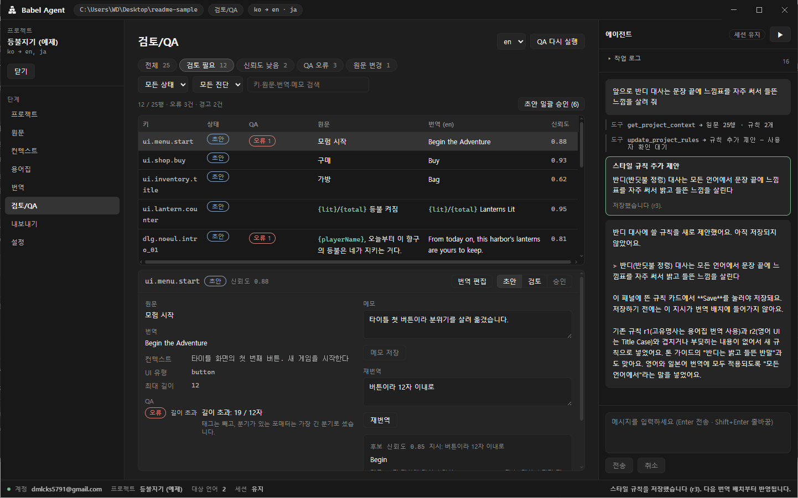
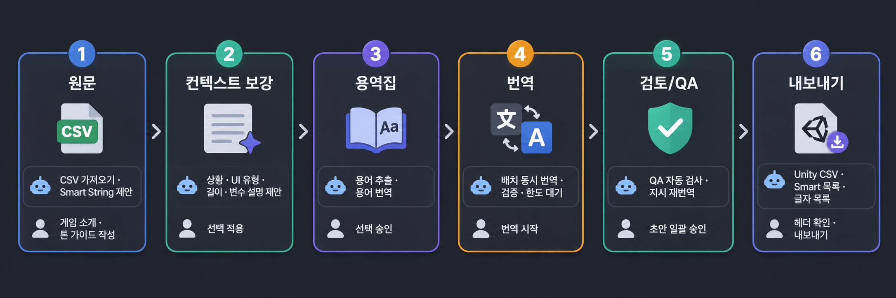
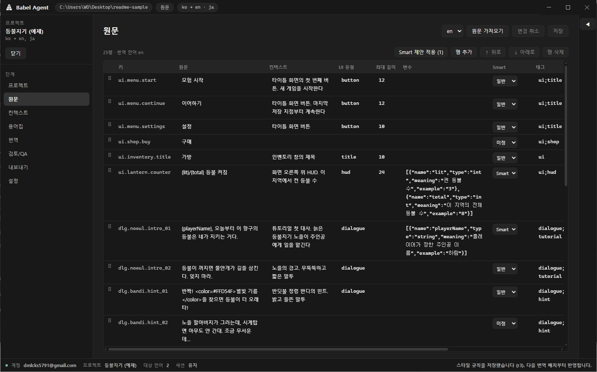
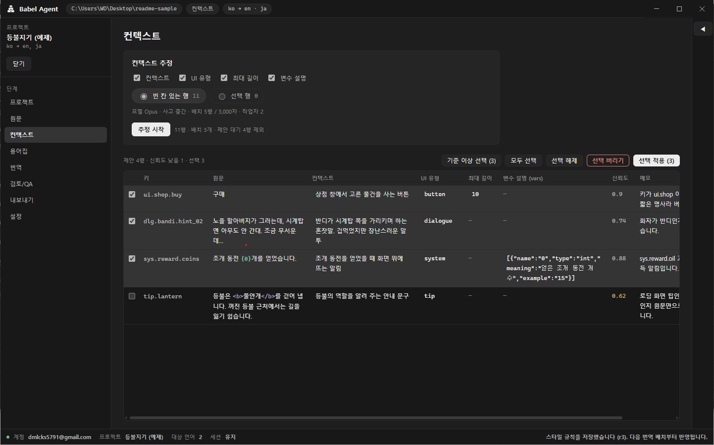
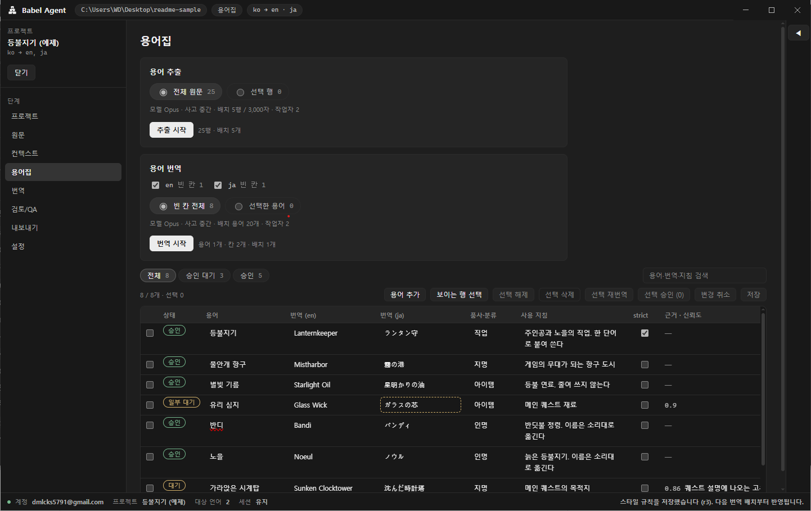
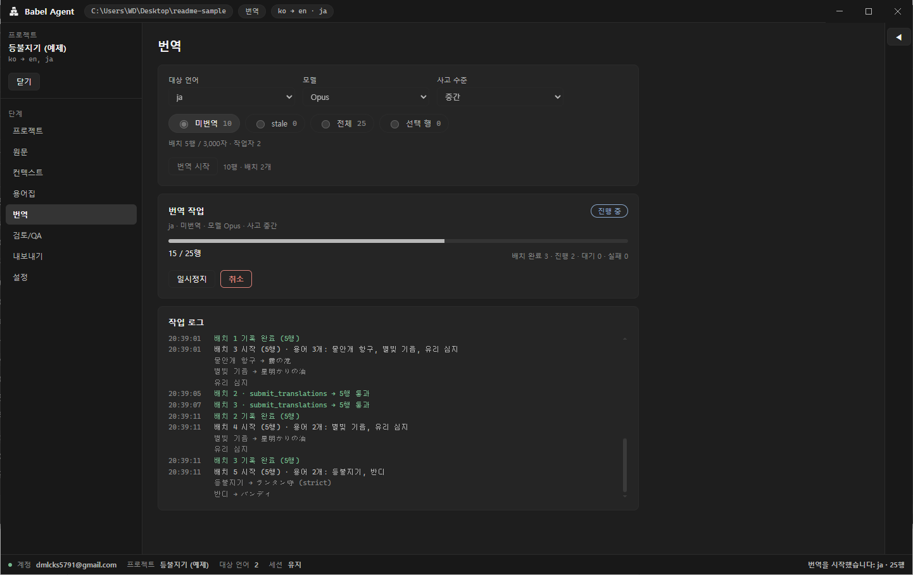
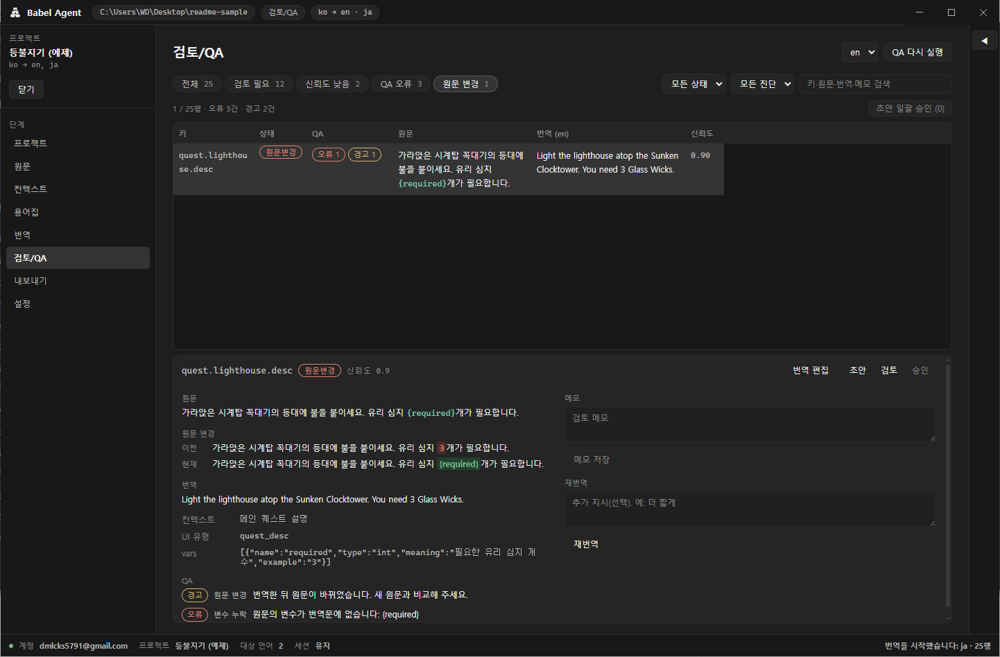
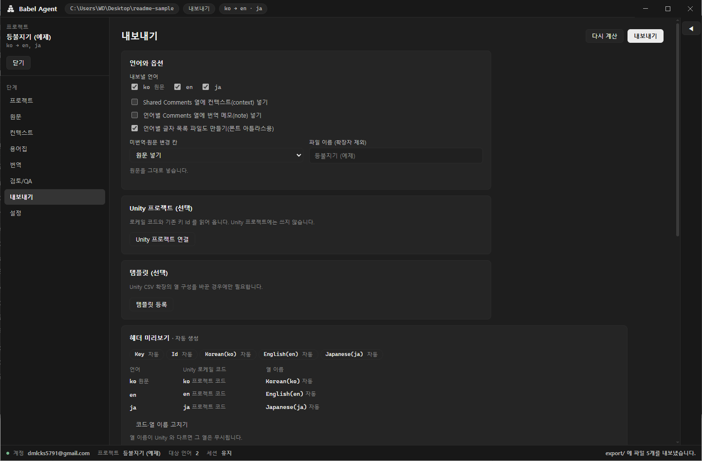
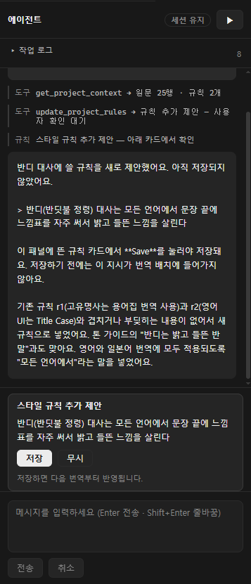

<div align="center">


# Babel Agent

### 게임 로컬라이제이션을 맡기는 AI 에이전트

원문을 넣으면 맥락을 채우고, 용어를 정리하고, 번역하고, 검사해서 내보냅니다.<br>
사람은 결과를 확인하고 승인하면 됩니다.

<!-- 영어 README 를 만들면 아래 줄의 주석을 풉니다 -->
<!-- **한국어** · [English](README.en.md) -->

[](https://github.com/Eucha09/BabelAgent/releases/latest)
[](https://github.com/Eucha09/BabelAgent/releases)


[](LICENSE)

[**Windows용 다운로드 →**](https://github.com/Eucha09/BabelAgent/releases/latest) · [릴리스 노트](https://github.com/Eucha09/BabelAgent/releases) · [버그 제보 · 기능 제안](https://github.com/Eucha09/BabelAgent/issues)



<sub>예제 프로젝트 「등불지기」 · 게임과 문장은 설명을 위해 지어낸 예시 데이터입니다</sub>

</div>

<br>

## 빠른 시작

1. [최신 릴리스](https://github.com/Eucha09/BabelAgent/releases/latest)에서 `BabelAgent-Setup-<버전>.exe`를 받아 실행합니다.
2. 앱을 켜면 PC의 **Claude Code**를 찾아 최신 버전으로 맞춥니다. 없으면 [설치]를 눌러 Anthropic의 공식 설치 스크립트로 설치합니다.
3. 설정 › 계정에서 Claude 구독 계정이나 Anthropic Console 계정으로 로그인합니다.
4. [새로 만들기]로 프로젝트 폴더를 만들고 원문 CSV를 가져옵니다. 그다음은 왼쪽 단계 메뉴를 위에서 아래로 따라가면 됩니다.

**필요한 것** — Windows 10(1809 이상)·11 64비트 · [Claude Code](https://code.claude.com/docs/en/setup)(없으면 앱이 설치를 안내합니다) · Claude Pro·Max 등 구독 계정 또는 Anthropic Console(API 과금) 계정

<sub>[왜 Babel Agent인가](#로컬라이제이션-이런-데서-막힙니다) · [일하는 방식](#에이전트가-하고-사람은-승인합니다) · [파이프라인](#파이프라인-한눈에-보기) · [단계별 소개](#단계별로-살펴보기) · [내보내기](#6-내보내기--unity에-바로-다른-곳에도-그대로) · [데이터](#데이터는-내-폴더의-csv로) · [계정과 요금](#계정과-요금) · [설치와 FAQ](#설치하기) · [개발](#개발하기)</sub>

<br>

## 로컬라이제이션, 이런 데서 막힙니다

게임 텍스트는 수천 줄이고, 그 대부분은 앞뒤 맥락 없이 키와 문장만 덩그러니 놓여 있습니다. 번역기에 붙여 넣으면 금방 끝날 것 같지만, 실제로 시간이 드는 곳은 번역 그 자체보다 그 앞뒤입니다.

| 지금까지는 | Babel Agent에서는 |
|---|---|
| `Start`가 버튼인지 대사인지, `{0}`이 이름인지 개수인지 모른 채 번역합니다 | 에이전트가 상황 설명 · UI 유형 · 최대 길이 · 변수 설명을 먼저 채워 제안합니다 |
| 같은 아이템 이름이 파일마다, 번역 차수마다 다르게 옮겨집니다 | 용어를 자동으로 뽑아 번역하고, 승인한 용어집을 매 번역에 넣습니다 |
| 시트를 수백 줄씩 잘라 번역기에 붙여 넣고, 결과를 다시 줄 맞춰 붙여 넣습니다 | 버튼 하나로 전체를 배치로 나눠 동시에 번역하고, 키 단위로 검증해 기록합니다 |
| `{playerName}`이나 `<color>` 태그가 깨진 채로 빌드에 들어가 게임에서야 발견됩니다 | 변수 · 태그 · Smart String · 길이를 코드로 검사하고, 오류가 남아 있으면 내보내기를 막습니다 |
| 원문이 바뀌면 어떤 번역을 다시 봐야 하는지 일일이 대조합니다 | 바뀐 원문의 번역을 자동으로 「원문 변경」으로 표시하고, 이전 원문과의 차이를 보여 줍니다 |
| "NPC는 반말로" 같은 지시를 번역을 맡길 때마다 다시 적습니다 | 한 번 정한 스타일 규칙이 프로젝트에 저장되어 이후 모든 번역에 들어갑니다 |
| 엔진으로 가져갈 때 열 이름 하나가 틀려 번역이 조용히 빠집니다 | Unity가 읽는 헤더를 그대로 만들고, 내보내기 전에 미리 보여 줍니다 |

<br>

## 에이전트가 하고, 사람은 승인합니다

Babel Agent의 파이프라인은 대부분의 단계를 **에이전트가 먼저 처리**합니다. 사람은 에이전트가 만든 제안과 번역을 보고 **승인하거나 고치기만** 하면 됩니다.

- **제안은 승인 전까지 확정되지 않습니다.** 컨텍스트 제안은 따로 쌓아 두고, 용어 후보는 「승인 대기」로, 번역은 「초안」으로 들어옵니다. 사람이 승인한 것만 다음 단계에 쓰입니다.
- **승인한 것은 에이전트가 덮어쓰지 않습니다.** 번역을 다시 돌려도 승인한 행은 건너뛰고, 작업 중에 사람이 고친 행도 그대로 둡니다.
- **언어 일은 에이전트가, 판정은 코드가 합니다.** CSV 읽기·쓰기, 키 검사, QA 판정은 LLM에 맡기지 않고 앱의 코드가 합니다. 에이전트는 정해진 형식으로 결과를 제출할 뿐이고, 기록할지는 코드가 검사해서 정합니다. 같은 입력이면 같은 판정이 나옵니다.
- **볼 것만 골라서 보여 줍니다.** 신뢰도가 낮은 행, QA에 걸린 행, 원문이 바뀐 행을 필터로 모으고, 문제없는 초안은 한 번에 승인합니다.

<br>

## 파이프라인 한눈에 보기



| 단계 | 자동으로 하는 일 | 사람이 하는 일 |
|---|---|---|
| **1. 원문** | Smart String 구문을 찾아 표시를 제안하고, 원문이 바뀐 번역을 찾아 표시합니다 | 원문 CSV를 가져오고 게임 소개 · 톤 가이드를 적습니다 |
| **2. 컨텍스트 보강** | 상황 설명 · UI 유형 · 최대 길이 · 변수 설명을 채워 제안합니다 | 훑어보고 [선택 적용] |
| **3. 용어집** | 원문에서 용어 후보를 뽑고, 언어별 번역을 채웁니다 | 확인하고 [선택 승인] |
| **4. 번역** | 배치로 나눠 동시에 번역하고, 행마다 신뢰도와 메모를 남깁니다 | 언어와 범위를 고르고 [번역 시작] |
| **5. 검토/QA** | 결과마다 QA를 돌리고, 지시를 받아 행을 다시 번역합니다 | [초안 일괄 승인], 필터에 걸린 행만 확인 |
| **6. 내보내기** | 엔진용 CSV · Smart 항목 목록 · 글자 목록을 만듭니다 | 헤더를 확인하고 [내보내기] |

<br>

## 단계별로 살펴보기

### 1. 원문 — 게임을 한 번 소개해 두면 됩니다

프로젝트 화면에 장르 · 게임 소개 · 톤 가이드를 한 번 적어 두면, 이후 모든 번역 요청에 자동으로 들어갑니다. 원문은 지금 쓰고 있는 CSV를 그대로 가져옵니다. 열 이름이 달라도 화면에서 어느 열이 키이고 원문인지만 짝지어 주면 됩니다.



<sub>원문 그리드 — 변수와 리치 텍스트 태그를 색으로 구분합니다</sub>

- **CSV 가져오기** — 열 매핑. UTF-8로 읽지 못하면 CP949로 다시 읽고 알려 줍니다. 다시 가져와도 행 순서와 기존 메타데이터는 그대로 둡니다
- **수천 행도 가볍게** — 가상 스크롤 그리드, 행 추가 · 삭제 · 순서 바꾸기(`Alt+↑/↓`)
- **Smart String 제안** — 원문에서 Unity Smart String 구문을 찾아 표시를 제안합니다
- **원문이 바뀌면** — 그 키의 번역을 모든 언어에서 「원문 변경」으로 표시합니다. 기존 번역은 지우지 않습니다

> **사람이 할 일** — 원문 CSV를 가져오고, 게임 소개와 톤 가이드를 몇 줄 적습니다.

### 2. 컨텍스트 보강 — 번역가가 물어볼 것을 미리 채웁니다

"이 문장은 누가, 어디서 하는 말인가요?" 사람 번역가라면 먼저 물어봤을 정보입니다. 에이전트가 키와 원문, 주변 문자열을 보고 빈 칸을 채워 제안합니다. 이렇게 채운 정보는 이후 번역에 그대로 들어갑니다.



<sub>제안마다 신뢰도와 근거 메모가 붙습니다</sub>

- **상황 설명 · UI 유형 · 최대 길이 · 변수 설명**(변수마다 종류 · 의미 · 예시)을 행마다 제안합니다
- **이미 채운 칸은 건드리지 않습니다.** 최대 길이는 버튼 · 탭처럼 제한이 분명한 짧은 문구에만, 번역이 길어질 여유를 두고 제안합니다
- 제안은 따로 쌓아 두고 **적용한 행만** 원문에 들어갑니다. 앱을 다시 켜도 제안은 남아 있습니다
- [기준 이상 선택]으로 신뢰도가 충분한 제안만 골라 한 번에 적용합니다

> **사람이 할 일** — [추정 시작]을 누르고, 제안을 훑어본 뒤 [선택 적용]을 누릅니다.

### 3. 용어집 — 고유명사는 끝까지 같은 이름으로

캐릭터 이름, 지명, 아이템, 스킬. 한 번 정한 번역이 게임 전체에서 흔들리지 않아야 합니다. 에이전트가 원문 전체에서 용어를 찾아 번역까지 채워 두면, 사람은 목록을 보고 승인만 합니다.



<sub>추출한 후보는 「승인 대기」로 들어오고, 승인한 용어만 번역과 QA에 쓰입니다</sub>

- **용어 추출** — 원문에서 고유명사 · 게임 용어 후보를 찾아 근거 · 신뢰도와 함께 올립니다. 이미 있는 용어는 다시 넣지 않습니다
- **용어 번역** — 빈 번역 칸을 언어별로 채웁니다. 용어가 쓰인 원문 예문과 다른 언어의 번역을 참고하고, 이미 있는 번역은 덮지 않습니다. 대상 언어를 늘리면 새 언어 칸만 채우면 됩니다
- **필요한 용어만 넣습니다** — 번역할 때는 그 배치 원문에 나오는 승인된 용어만 골라 넣어, 용어집이 커져도 요청이 불필요하게 길어지지 않습니다
- **strict** — 꼭 지켜야 하는 용어에 켜 두면, 이를 어긴 번역은 QA 오류가 되어 내보내기가 막힙니다
- [용어 추가]로 하나만 넣거나, "영어는 더 짧게, 일본어는 가타카나로" 같은 지시를 붙여 [선택 재번역]할 수 있습니다

> **사람이 할 일** — [용어 추출] → [용어 번역]을 누르고, 결과를 확인해 [선택 승인]을 누릅니다.

### 4. 번역 — 수천 줄도 버튼 하나로

언어와 범위(미번역 · 원문 변경 · 전체 · 선택 행)를 고르고 시작하면, 에이전트가 원문을 배치로 나눠 동시에 번역합니다. 배치마다 게임 소개, 톤 가이드, 스타일 규칙, 그 배치에 나오는 용어, 행별 컨텍스트가 함께 들어갑니다.



<sub>배치 진행률과 작업 로그. 일시정지 · 재개 · 취소할 수 있습니다</sub>

- **자동 분할과 동시 실행** — 30행 또는 원문 3,000자 단위로 나누고(프로젝트에서 조절), 작업자 1~3개가 동시에 번역합니다
- **검증을 통과한 결과만 기록** — 코드가 키 누락 · 중복, 빈 번역, 변수 · 태그를 검사합니다. 문제가 있으면 에이전트에게 한 번 고칠 기회를 주고, 그래도 안 되면 그 배치는 기록하지 않습니다. 반쯤 쓰인 결과가 남지 않습니다
- **승인한 번역은 건너뜁니다** — 몇 번을 다시 돌려도 승인한 행은 건드리지 않습니다
- **사용량 한도에 걸려도** — 모든 작업자를 멈추고 진행 중이던 배치를 되돌린 뒤, 한도가 풀리는 시각에 맞춰 자동으로 다시 시작합니다. 남은 대기 시간과 [지금 재시도] 버튼을 보여 줍니다
- **중간에 멈춰도** — 같은 범위로 다시 실행하면 남은 행부터 이어서 번역합니다
- **모델과 사고 수준** — Opus · Sonnet · Haiku와 사고 수준을 프로젝트마다 고릅니다. 에이전트는 행마다 신뢰도와 메모를 남깁니다

> **사람이 할 일** — 언어와 범위를 고르고 [번역 시작]을 누릅니다. 그다음은 기다리면 됩니다.

### 5. 검토/QA — 확인할 행만 골라 보여 줍니다

번역이 기록되면 바로 QA가 돕니다. 판정은 LLM이 아니라 코드가 하므로, 같은 번역이면 언제나 같은 결과가 나옵니다.



<sub>원문 변경 행은 번역할 때 본 원문과 지금 원문의 차이를 보여 줍니다</sub>

| 검사 | 심각도 |
|---|---|
| 변수 누락 · 추가 (`{playerName}`, `{0}`) | 오류 |
| Unity Smart String 중괄호 짝 | 오류 |
| 리치 텍스트 태그 집합 · 짝 (`<color>`, `<b>` …) | 오류 |
| 최대 길이 초과 | 오류 |
| 빈 번역 | 오류 |
| 용어집 위반 | 경고 (strict 용어는 오류) |
| 목록에 없는 Smart String 포매터 | 경고 |
| 원문 변경 | 경고 |

오류는 승인과 내보내기를 막고, 경고는 막지 않습니다. 변수와 태그는 순서가 아니라 **집합**으로 비교합니다 — 언어마다 어순이 다르기 때문입니다. Smart String 검사는 프로젝트의 SmartFormat 설정(이스케이프 방식, 대소문자 구분, 포매터 목록)을 따릅니다.

- **빠른 필터** — 검토 필요 · 신뢰도 낮음 · QA 오류 · 원문 변경. 전부 보지 않고 볼 것만 봅니다
- **초안 일괄 승인** — QA 오류 · 경고가 없고 신뢰도가 기준 이상인 초안을 한 번에 승인합니다
- **지시를 붙인 재번역** — "더 짧게, 존댓말로" 같은 지시로 그 행만 다시 번역해 후보를 받고, 적용할지는 사람이 고릅니다
- **키보드로 빠르게** — `↑↓` 이동 · `Enter` 편집 · `Ctrl+Enter` 저장 · `Esc` 취소. 고친 행은 바로 저장됩니다

> **사람이 할 일** — [초안 일괄 승인]을 한 번 누르고, 필터에 걸린 행만 확인합니다.

### 6. 내보내기 — Unity에 바로, 다른 곳에도 그대로

지금은 **Unity Localization의 String Table에 바로 가져올 수 있는 CSV**를 기본으로 만듭니다. Unity에서 샘플을 먼저 내보내거나 템플릿을 준비할 필요가 없습니다.



<sub>만들어질 헤더를 열마다 출처(자동 · 설정 · Unity · 템플릿)와 함께 미리 보여 줍니다</sub>

```csv
Key,Id,Korean(ko),English(en),Japanese(ja)
ui.menu.start,,모험 시작,Start,冒険を始める
item.starlight_oil.name,,별빛 기름,Starlight Oil,星明かりの油
sys.reward.oil,,별빛 기름 {count}병을 얻었습니다.,You got {count:plural:{} bottle|{} bottles} of Starlight Oil.,星明かりの油を{count}本手に入れた。
```

**Unity Localization과 함께 쓸 때**

- **헤더를 Unity 이름 그대로** — `English(en)`, `Chinese (Simplified)(zh-Hans)`처럼 Unity가 실제로 읽는 열 이름을 만듭니다. 열 이름이 한 글자만 달라도 Unity는 그 열을 오류 없이 건너뛰기 때문에, 내보내기 전에 헤더 전체를 보여 줍니다
- **Unity 프로젝트 연결(선택)** — 로케일 에셋과 String Table 공유 데이터를 **읽기만** 해서 실제 로케일 코드와 기존 키의 Id를 가져옵니다. Unity 프로젝트에는 아무것도 쓰지 않습니다
- **템플릿(선택)** — CSV 확장의 열 구성을 바꾼 프로젝트라면 Unity에서 내보낸 CSV를 등록해 그 열 이름과 순서를 따릅니다
- **Smart 항목 목록** — Unity CSV는 Smart String 여부를 옮기지 않으므로 `{이름}_smart.csv`로 따로 씁니다
- 가져올 때는 Localization Tables 창의 Import › **CSV(Merge)...** 를 씁니다. `CSV...`는 파일에 없는 키를 컬렉션에서 지웁니다

**Unity를 쓰지 않아도 충분히 쓸 수 있습니다**

결과물은 키 한 열에 언어마다 한 열인, 평범한 UTF-8 CSV입니다. 특정 엔진에 묶인 형식이 아니라서 어디로든 가져갈 수 있습니다.

- **엑셀 · Google 시트** — 그대로 열어 외부 번역 업체나 QA 담당자에게 넘깁니다
- **자체 로더 · 다른 엔진** — 키-값 CSV를 읽을 수 있는 로컬라이제이션 시스템이라면 그대로 가져갈 수 있습니다. Unity 전용인 `Id` 열은 비워 두니 무시하면 됩니다
- **원하는 헤더로** — 언어 열 이름은 프로젝트 화면에서 언어마다 바꿀 수 있고, 템플릿을 등록하면 열 이름과 순서까지 원하는 대로 맞춥니다. 주석 열은 켜고 끕니다
- **빈 칸 처리** — 미번역 칸을 비울지, 원문으로 채울지, 그 행을 뺄지 고릅니다
- **언어별 글자 목록**(`_chars_{언어}.txt`) — 번역에 쓰인 글자를 모아 줍니다. 폰트 아틀라스(TextMesh Pro 등)를 만들 때 그대로 넣으면 됩니다
- 프로젝트 폴더의 `translations_{언어}.csv` 자체도 키 · 번역 · 상태가 든 CSV라 빌드 스크립트에서 바로 읽을 수 있습니다

> **사람이 할 일** — 헤더 미리보기를 확인하고 [내보내기]를 누릅니다.

### 에이전트 패널 — 말로 정한 규칙이 프로젝트에 남습니다

오른쪽 에이전트 패널에서 프로젝트에 대해 묻거나 지시를 줍니다. "앞으로 NPC 대사는 반말로"처럼 계속 지켜야 할 지시는 **확인 카드**로 뜨고, [저장]을 누르면 프로젝트의 스타일 규칙이 되어 다음 번역부터 모든 배치에 들어갑니다.



<sub>대화 속에만 남는 결정은 없습니다. 저장한 규칙은 프로젝트 화면에서 언제든 고치거나 지웁니다</sub>

<br>

## 데이터는 내 폴더의 CSV로

프로젝트는 폴더 하나이고, **그 안의 CSV가 원본**입니다. 앱 안에 따로 숨겨 둔 데이터베이스가 없습니다.

```
등불지기/
├─ project.json             언어, 게임 소개, 톤 가이드, 스타일 규칙, 번역·내보내기 설정
├─ strings_master.csv       원문과 메타데이터(컨텍스트, UI 유형, 최대 길이, 변수 설명, Smart 여부)
├─ translations_en.csv      언어별 번역 · 상태 · 신뢰도 · 메모
├─ translations_ja.csv
├─ glossary.csv             용어집
├─ context_suggestions.csv  승인을 기다리는 컨텍스트 제안
└─ export/                  내보낸 파일
```

- **엑셀로 열고, Git으로 이력을 남기고, 폴더째 팀과 나눕니다**
- **원본이 깨지지 않게** — 저장은 임시 파일에 쓴 뒤 교체합니다. 작업 중 앱이 꺼져도 반쯤 쓰인 파일이 남지 않습니다
- **조용히 덮어쓰지 않습니다** — 앱 밖에서 파일이 바뀌면 감지해 다시 읽고, 편집 중이었다면 저장할 때 충돌을 알려 줍니다
- **엑셀이 잡고 있는 파일** — 저장이 막히면 엑셀에서 파일이 열려 있는지 확인하라고 알려 줍니다
- 번역 상태는 다섯 가지뿐입니다: 미번역 · 초안 · 검토 · 승인 · 원문 변경

<br>

## 계정과 요금

Babel Agent의 에이전트는 PC에 설치된 **Claude Code**로 실행되고, Claude Code에 로그인한 방식을 그대로 씁니다.

| 계정 | 요금 | 앱에서 보이는 것 |
|---|---|---|
| **Claude 구독**(Pro · Max 등) | 구독의 사용량 한도 안에서 동작 | 설정 화면의 5시간 · 주간 한도 막대와 초기화 시각 |
| **Anthropic Console** | 사용량만큼 API 요금 | 사용량과 요금은 [Claude Console](https://platform.claude.com/)에서 확인 |

- **앱은 로그인 정보를 받지 않습니다.** 로그인은 Claude Code가 자기 창에서 진행하고, 앱은 로그인 코드 · 토큰 · API 키를 받거나 저장하지 않습니다. 환경 변수 `ANTHROPIC_API_KEY`도 Claude Code가 쓰는 그대로 따릅니다
- **사용량을 아끼는 구조** — 배치마다 필요한 데이터를 한 번에 넣어 에이전트가 파일을 찾아 읽느라 턴을 쓰지 않게 하고, 매번 같은 앞부분(역할 · 게임 소개 · 톤 가이드)을 먼저 두어 프롬프트 캐시가 잘 맞게 조립합니다
- Anthropic의 안내에 따르면 Pro · Max 한도는 일반적인 개인 사용을 기준으로 합니다. 큰 배치 번역을 자주 돌리면 한도에 걸릴 수 있고, 그때 앱은 작업을 멈췄다가 한도가 풀리면 이어서 합니다

<br>

## 설치하기

설치 순서는 위 [빠른 시작](#빠른-시작)이 전부입니다. 아래는 그 밖에 알아 두면 좋은 것들입니다.

- **파일** — [최신 릴리스](https://github.com/Eucha09/BabelAgent/releases/latest)의 `BabelAgent-Setup-<버전>.exe`, 약 110 MB. 설치할 때 위치를 고를 수 있습니다.
- **Claude Code** — 앱에 들어 있지 않습니다. 앱을 켤 때마다 PC의 Claude Code를 찾아 최신 버전으로 업데이트합니다. 없으면 [설치]를 눌렀을 때만, 보이는 창에서 Anthropic의 공식 설치 스크립트(`irm https://claude.ai/install.ps1 | iex`)를 실행합니다. 관리자 권한은 필요 없습니다.
- **업데이트** — 앱을 켤 때와 켜 둔 동안 6시간마다 새 버전을 확인해 하단 상태바에 알려 줍니다. [받기]를 눌러야 받고, [다시 시작해 설치]를 누르거나 앱을 끌 때 설치됩니다. 번역 작업이 도는 중에는 다시 시작하지 않습니다.
- **제거** — Windows 설정 › 앱에서 Babel Agent를 제거합니다. 프로젝트 폴더는 그대로 남습니다.

<details>
<summary>설치할 때 Windows SmartScreen 경고가 뜬다면</summary>
<br>

설치 파일에는 아직 코드 서명이 없습니다. [공식 릴리스](https://github.com/Eucha09/BabelAgent/releases)에서 받은 파일인지 확인한 뒤 **추가 정보 → 실행**을 누르세요. 앱 안의 자동 업데이트는 릴리스의 `latest.yml`에 적힌 SHA-512 해시로 받은 파일을 검사합니다.

</details>

<details>
<summary>자주 묻는 질문</summary>
<br>

**Unity를 쓰지 않아도 되나요?**<br>
네. 내보내기 결과는 키 한 열에 언어마다 한 열인 UTF-8 CSV라서 엑셀, 자체 로더, 다른 엔진의 CSV 가져오기에서 그대로 쓸 수 있습니다. 열 이름과 순서도 바꿀 수 있습니다. [내보내기](#6-내보내기--unity에-바로-다른-곳에도-그대로)를 참고하세요.

**원문이 한국어가 아니어도 되나요?**<br>
네. 원문 언어와 대상 언어는 프로젝트마다 정합니다. 앱은 특정 원문 언어나 장르를 가정하지 않고, 장르 · 게임 소개 · 톤 가이드는 프로젝트에 적은 대로 씁니다. 화면 언어(한국어 · English)도 번역 언어와 상관없이 설정에서 고릅니다.

**번역 품질을 높이려면 무엇부터 하면 되나요?**<br>
게임 소개와 톤 가이드를 구체적으로 적는 것이 가장 효과가 큽니다. 그다음 컨텍스트 보강으로 문장마다 상황을 채우고, 용어집을 승인해 두세요. 반복해서 고치게 되는 점은 에이전트 패널에서 스타일 규칙으로 저장하면 다음 번역부터 반영됩니다.

**사용량 한도에 걸리면 어떻게 되나요?**<br>
진행 중이던 배치를 포함해 모든 작업자를 멈추고, 그 배치는 기록하지 않고 대기열 앞으로 되돌립니다. 한도가 풀리는 시각을 알면 그때 자동으로 다시 시작하고, 모르면 간격을 늘려 가며 기다립니다. 언제든 [지금 재시도]를 누를 수 있습니다.

**원문과 번역은 어디로 전송되나요?**<br>
번역에 필요한 내용(원문, 게임 소개, 톤 가이드, 관련 용어)은 Claude Code를 거쳐 Anthropic으로 전송됩니다. 프로젝트 파일은 내 PC의 폴더에만 있고, 앱은 별도의 서버나 분석 · 텔레메트리를 두지 않습니다. 앱이 직접 접속하는 곳은 업데이트를 확인하는 GitHub Releases, 그리고 [설치]를 눌렀을 때의 Claude Code 공식 설치 스크립트입니다.

**엑셀로 열어서 고쳐도 되나요?**<br>
네. 엑셀이 CP949로 저장해도 앱이 다시 읽고 알려 주며, 앱은 항상 UTF-8로 저장합니다. 앱 밖에서 바뀐 파일은 다시 읽고, 앱에서 편집 중이었다면 저장할 때 어느 쪽을 남길지 묻습니다.

**macOS나 Linux는요?**<br>
지금은 Windows에서만 검증하고 배포합니다.

</details>

<br>

## 개발하기

Electron · React · TypeScript로 만들고, 에이전트는 [Claude Agent SDK](https://code.claude.com/docs/en/agent-sdk/overview)로 실행합니다. Node.js 20 이상이 필요합니다.

```bash
npm install
npm run dev        # 개발 모드 실행 (Windows는 run-dev.bat을 더블클릭해도 됩니다)
npm test           # 단위 테스트(Vitest)
npm run typecheck  # 타입 검사
npm run dist       # 설치 파일 만들기 → dist/ (올리지 않음)
```

| 경로 | 역할 |
|---|---|
| `src/main` | Electron 메인 — Agent SDK 세션, 작업 스케줄러, 파일 입출력, 에이전트용 MCP 도구 |
| `src/preload` | 렌더러에 노출하는 IPC |
| `src/renderer` | React 화면 — 단계별 화면, 그리드, 에이전트 패널 |
| `src/core` | Electron에 의존하지 않는 결정론적 로직 — CSV, 해시, QA, Smart String 토크나이저, 내보내기 |
| `src/shared` | IPC 채널, zod 스키마, 화면 문구 카탈로그(`i18n`) |

릴리스는 `release.bat`을 실행하고 새 버전을 입력하면 됩니다. typecheck · test를 통과하면 버전 커밋과 태그를 올리고, GitHub Actions가 설치 파일을 빌드해 Releases에 공개합니다. 구조와 규칙은 [CLAUDE.md](CLAUDE.md)와 `docs/`에 있습니다.

- [docs/architecture.md](docs/architecture.md) — 프로세스 경계, IPC 채널, MCP 도구, 작업 스케줄러, 인증과 Claude Code
- [docs/data-format.md](docs/data-format.md) — project.json과 CSV 열 정의, 상태 전이
- [docs/agent-prompts.md](docs/agent-prompts.md) — 프롬프트 조립, 배치 산정, 한도 처리
- [docs/qa-rules.md](docs/qa-rules.md) — QA 검사 규칙
- [docs/unity-export.md](docs/unity-export.md) — Unity 내보내기와 확인한 Unity 가져오기 동작
- [docs/roadmap.md](docs/roadmap.md) — 마일스톤과 결정 기록

<br>

---

<div align="center">

**더 쓰기 좋은 도구로 함께 다듬어 가요.** [버그와 아이디어](https://github.com/Eucha09/BabelAgent/issues)를 남겨 주세요. 도움이 됐다면 [⭐ Star](https://github.com/Eucha09/BabelAgent/stargazers)로 응원해 주세요.

[MIT License](LICENSE)

<sub>Claude와 Claude Code는 Anthropic의 상표입니다. Babel Agent는 Claude Code를 실행하는 독립 앱이며 Anthropic이 만들거나 보증하지 않습니다.<br>앱이 쓰는 Claude Agent SDK와 Claude Code는 [Anthropic의 약관](https://code.claude.com/docs/en/legal-and-compliance)을, 그 밖의 의존 패키지는 각자의 라이선스를 따릅니다.</sub>

</div>
