# 튜토리얼 — 예제 프로젝트로 한 바퀴 돌아보기

예제 게임 「등불지기」의 한국어 문장 25줄을 **영어와 일본어로 번역해 내보내는 것**까지 따라 해 봅니다.

대부분의 일은 에이전트가 합니다. 여러분은 버튼을 누르고, 결과를 보고, 승인하면 됩니다.

> **「등불지기」는 어떤 게임인가요?**<br>
> 물안개에 잠긴 항구 도시에서 견습 등불지기가 꺼진 등불을 다시 밝히는 아늑한 판타지 어드벤처입니다. 설명을 위해 지어낸 게임입니다.

**준비물**

- Babel Agent 설치 — [README의 빠른 시작](../README.md#빠른-시작)을 보세요
- Claude 구독 계정(Pro · Max 등) 또는 Anthropic Console 계정

**순서**

0. [예제 파일 받기](#0-예제-파일-받기)
1. [Claude Code 연결하기](#1-claude-code-연결하기)
2. [프로젝트 만들기](#2-프로젝트-만들기)
3. [게임 소개와 톤 가이드 적기](#3-게임-소개와-톤-가이드-적기)
4. [원문 가져오기](#4-원문-가져오기)
5. [컨텍스트 채우기](#5-컨텍스트-채우기)
6. [용어집 만들기](#6-용어집-만들기)
7. [번역하기](#7-번역하기)
8. [검토하고 승인하기](#8-검토하고-승인하기)
9. [내보내기](#9-내보내기)

> 에이전트 작업은 모두 다섯 번(컨텍스트 1번, 용어 2번, 번역 2번) 돌아갑니다. 25줄짜리라 사용량은 많지 않습니다.

<br>

## 0. 예제 파일 받기

1. [예제 파일(lanternkeeper-strings.csv)](tutorial-sample/lanternkeeper-strings.csv)을 엽니다.
2. 오른쪽 위의 **다운로드 버튼**(Download raw file)을 누릅니다. 다운로드 폴더 같은 곳에 저장해 두면 됩니다.

게임에서 쓰는 문장 목록을 그대로 옮겨 온 파일이라고 생각하면 됩니다. 문장마다 **키**와 **원문**이 있고, 설명(컨텍스트)은 5줄에만 적혀 있습니다. 비어 있는 설명은 뒤에서 에이전트가 채웁니다. 이 파일은 4단계에서 프로젝트로 가져옵니다.

<br>

## 1. Claude Code 연결하기

Babel Agent의 에이전트는 PC에 설치된 **Claude Code**로 일합니다. 먼저 Claude Code를 준비하고 로그인합니다.

1. Babel Agent를 켭니다. 가운데에 **Claude Code 확인 중…** 창이 뜹니다. Claude Code를 최신으로 맞춘 뒤 저절로 닫힙니다.
   - **Claude Code 가 필요합니다**라고 뜨면 [설치]를 누릅니다. 새 창에서 설치가 진행되고, 끝나면 그 창에서 Enter를 눌러 닫습니다.
2. 왼쪽 메뉴 맨 아래의 [설정]을 누릅니다.
3. **계정** 카드의 상태를 봅니다.
   - **로그인됨**이면 다음 단계로 넘어갑니다.
   - 아니라면 구독 계정은 [Claude 계정(구독)으로 로그인], API 계정은 [Console(API 과금)로 로그인]을 누릅니다. 새 창과 브라우저에서 로그인을 마치면 창이 닫히고 **로그인됨**으로 바뀝니다. 코드를 붙여 넣으라고 하면 그 새 창에 붙여 넣습니다.

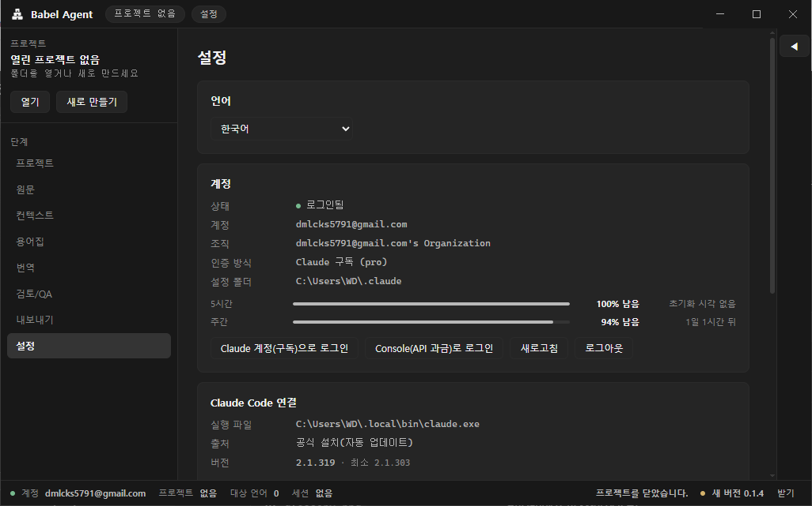

> 로그인은 Claude Code가 자기 창에서 진행합니다. Babel Agent는 비밀번호나 토큰을 받지 않습니다.

<br>

## 2. 프로젝트 만들기

Babel Agent의 프로젝트는 **폴더 하나**입니다. 번역 파일과 설정이 모두 이 폴더에 저장됩니다.

1. 첫 화면에서 [새 프로젝트 만들기]를 누릅니다.
2. 폴더를 고르는 창이 뜹니다. 바탕 화면 같은 곳에서 [새 폴더]를 눌러 `등불지기` 폴더를 만들고, 그 폴더를 고른 뒤 [폴더 선택]을 누릅니다.
3. **새 프로젝트** 창에서 프로젝트 이름에 `등불지기`를 적습니다. 원문 언어(`ko`)와 대상 언어(`en`, `ja`)는 이미 들어 있으니 그대로 둡니다.
4. [만들기]를 누릅니다.

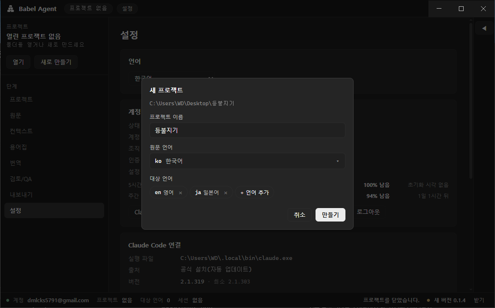

프로젝트가 만들어지고 **프로젝트** 화면이 열립니다.

<br>

## 3. 게임 소개와 톤 가이드 적기

에이전트에게 게임을 소개하는 단계입니다. 여기에 적은 내용은 앞으로 모든 번역에 함께 들어갑니다. 처음 합류한 번역가에게 게임을 설명한다고 생각하면 됩니다.

**게임** 칸에 아래 내용을 복사해 붙여 넣으세요.

> **내 게임에 쓸 때는** `[세계관]`, `[UI · 버튼 · 메뉴]` 같은 항목 제목은 그대로 두고 내용만 바꾸세요. 해당 없는 항목은 지우면 됩니다. 아래에 [빈 양식](#blank-template)도 있습니다.

**장르** — 장르와 함께 분위기, 플레이 형태, 이용 등급을 적으면 표현 수위를 맞추는 데 도움이 됩니다.

```
아늑한 판타지 어드벤처 · 탐험과 퍼즐 · 1인용 · 전체 이용가
```

**게임 소개** — 번역에 필요한 배경을 항목별로 나눠 적습니다.

```
[세계관]
물안개에 잠긴 항구 도시 '물안개 항구'가 무대다. 밤마다 바다에서 짙은 안개가 올라오고, 등불이 켜진 곳에서만 길이 보인다. 오래전 도시의 시계탑이 바다에 가라앉은 뒤로 안개가 점점 짙어지고 있다.

[주요 인물]
- 주인공: 견습 등불지기. 이름은 플레이어가 정한다({playerName}). 성별은 정해져 있지 않다.
- 노을: 늙은 등불지기이자 주인공의 스승. 말수가 적고 무뚝뚝하지만 속정이 깊다.
- 반디: 반딧불 정령. 주인공 곁을 따라다니며 힌트를 준다. 호기심 많고 수다스럽다.
- 상인: 항구에서 가게를 하는 친절한 상인.

[게임 흐름]
1. 노을에게 등불지기 일을 배운다(튜토리얼).
2. 지역마다 꺼진 등불을 다시 켜 안개를 걷어 내고 새 길을 연다.
3. 재료를 모아 더 큰 등불과 등대를 밝힌다.
4. 가라앉은 시계탑 꼭대기의 등대를 밝혀 안개의 비밀을 푼다.

[핵심 시스템]
- 등불: 켜면 주변의 안개가 걷히고 길이 열린다.
- 아이템: 별빛 기름(등불 연료), 유리 심지(퀘스트 재료).
- 화폐: 조개 동전. 상점에서 아이템을 산다.
- 업적: 특정 행동을 처음 해냈을 때 열린다.
```

**톤 가이드** — 텍스트 유형마다 말투를 정합니다. 대상 언어별로 따로 정할 것이 있으면 함께 적습니다.

```
[공통]
- 따뜻하고 차분하게. 공포보다 아늑함이 앞서게 한다. 어둠과 안개도 무섭기보다 신비롭게.
- 주인공의 성별이 드러나는 표현을 쓰지 않는다.
- 비속어와 과격한 표현을 쓰지 않는다(전체 이용가).

[UI · 버튼 · 메뉴]
- 짧은 명사형이나 동사형으로. 마침표를 붙이지 않는다.
- 영어는 Title Case로 쓴다(예: Start Game).

[대사]
- 노을: 무뚝뚝하고 짧은 반말. 영어는 짧고 퉁명스럽게, 일본어는 거친 말투(~だ, ~ろ).
- 반디: 밝고 들뜬 반말, 감탄사가 많다. 영어는 경쾌하게, 일본어는 아이 같은 반말.
- 상인: 친근한 존댓말. 영어는 친절하고 공손하게, 일본어는 です・ます체.

[퀘스트]
- 제목은 짧은 명령형(예: 꺼진 등대를 밝혀라).
- 설명은 해야 할 일을 분명하게, 존댓말로.

[아이템]
- 이름은 명사형. 설명은 한두 문장으로, 동화 같은 묘사를 살린다.

[시스템 메시지 · 알림]
- 짧고 분명하게, 존댓말로.

[팁 · 안내]
- 플레이어에게 말을 거는 부드러운 존댓말(~하세요).
```

다 붙여 넣었으면 [저장]을 누릅니다. 다른 설정은 건드리지 않아도 됩니다.

<a name="blank-template"></a>

<details>
<summary><b>빈 양식</b> — 내 게임에 쓸 때 복사해서 채우세요</summary>
<br>

**장르**

```
(장르) · (플레이 형태) · (인원) · (이용 등급)
```

**게임 소개**

```
[세계관]
(무대, 시대, 분위기)

[주요 인물]
- (이름): (역할, 성격, 말버릇)

[게임 흐름]
1. (플레이어가 처음 하는 일)
2. (반복해서 하는 일)
3. (최종 목표)

[핵심 시스템]
- (시스템 이름): (무엇을 하는지)
```

**톤 가이드**

```
[공통]
- (전체 분위기, 피할 표현, 이용 등급)

[UI · 버튼 · 메뉴]
- (길이, 형태, 대소문자 규칙)

[대사]
- (인물): (말투. 대상 언어별로 다르게 할 점)

[퀘스트]
- (제목과 설명의 형태)

[아이템]
- (이름과 설명의 형태)

[시스템 메시지 · 알림]
- (말투)

[팁 · 안내]
- (말투)
```

</details>

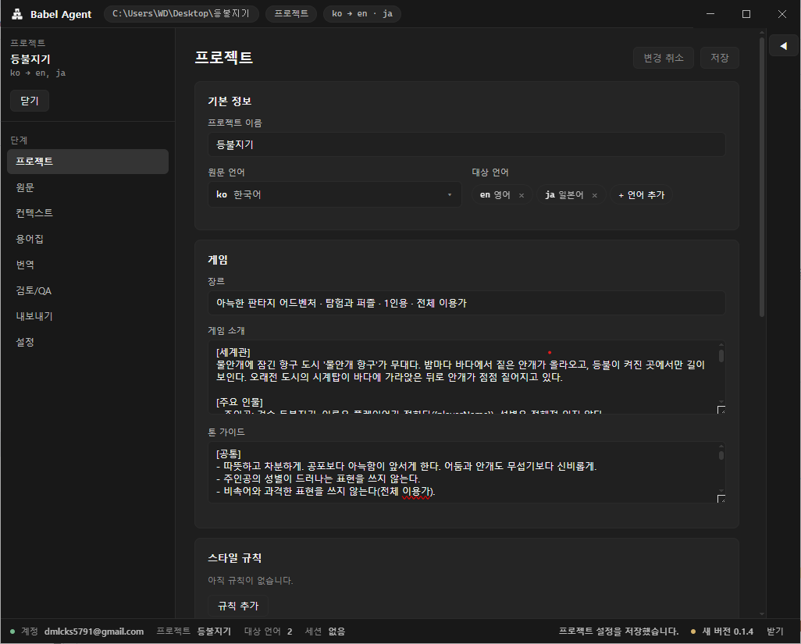

> **스타일 규칙은 지금 비워 두세요.** "NPC 대사는 반말로"처럼 지켜야 할 규칙은 작업하다가 필요해질 때 에이전트에게 말로 부탁하면 추가됩니다. 8단계에서 한 번 해 봅니다.

<br>

## 4. 원문 가져오기

0단계에서 받은 예제 파일을 프로젝트로 가져옵니다.

1. 왼쪽 메뉴에서 [원문]을 누릅니다. 아직 원문이 없어서 **원문 파일이 없습니다**라고 나옵니다.
2. 위쪽의 [원문 가져오기]를 누르고, 0단계에서 받은 `lanternkeeper-strings.csv`를 고릅니다.
3. **원문 가져오기** 창이 뜹니다. 파일의 열이 키 · 원문 · 컨텍스트에 이미 짝지어져 있으니 그대로 [가져오기]를 누릅니다.

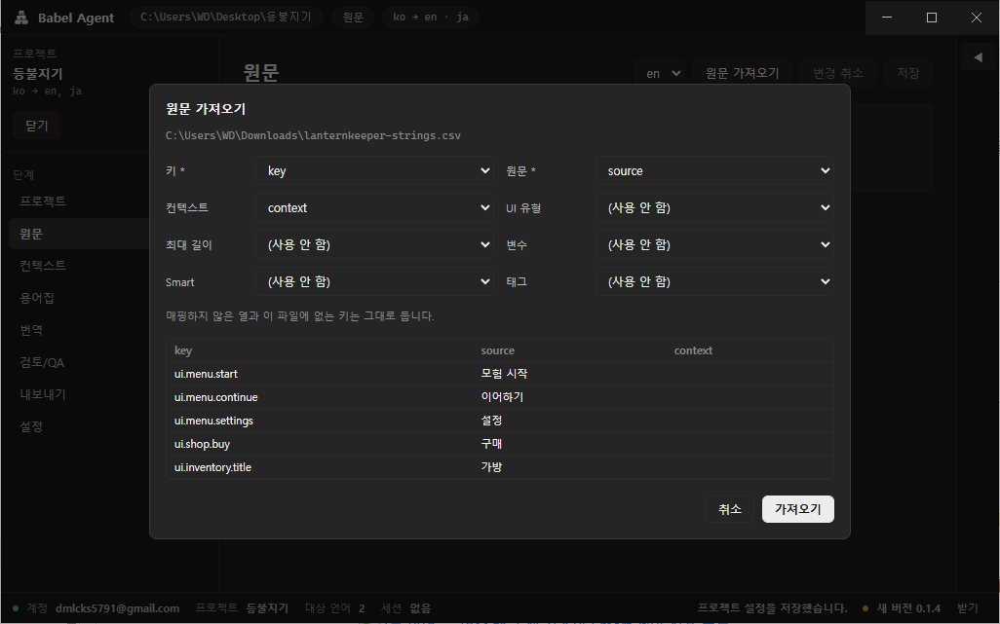

25줄이 들어왔습니다. 그리드를 한번 둘러보세요.

- `{playerName}` 같은 **변수**는 초록색, `<color=…>` 같은 **태그**는 보라색으로 보입니다. 번역할 때 깨지면 안 되는 부분입니다.
- **컨텍스트**는 5줄에만 적혀 있습니다. 나머지는 다음 단계에서 채웁니다.

마지막으로 위쪽의 [Smart 제안 적용 (5)]를 누르고 [저장]을 누릅니다. 변수가 든 5줄이 Smart로 표시됩니다.

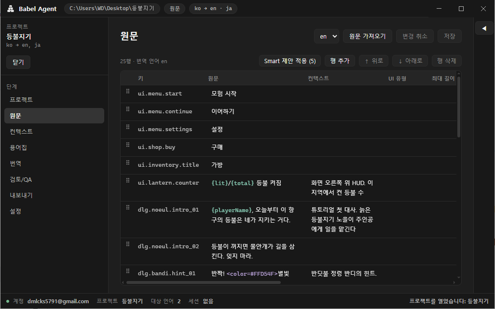

> **Smart가 뭔가요?** 변수가 들어 있는 문장을 Unity의 Smart String으로 표시하는 것입니다. 내보낼 때 Smart 문장 목록을 따로 만들어 줍니다. Unity를 쓰지 않는다면 신경 쓰지 않아도 됩니다.

### 내 게임의 원문 파일은 이렇게 준비하세요

- **키와 원문은 꼭 있어야 합니다.** 키는 문장마다 붙인 고유한 이름(예: `ui.menu.start`)이고, 원문은 번역할 문장입니다.
- **컨텍스트는 원문만 봐서는 이해하기 어려운 줄에만 적으면 됩니다.** 예제에서는 화면 어디에 뜨는지 알 수 없는 `{lit}/{total} 등불 켜짐`, 누가 하는 말인지 알 수 없는 `반짝! …` 같은 줄에만 적었습니다. 나머지는 다음 단계에서 에이전트가 채웁니다.
- UI 유형, 최대 길이 같은 다른 정보는 없어도 됩니다. 이미 정해 둔 값이 있으면 열로 넣어 함께 가져올 수 있습니다.
- 엑셀 등으로 관리하던 목록은 CSV로 저장해 가져오면 됩니다. 열 이름이 달라도 가져오기 창에서 짝지어 줄 수 있습니다.
- **원문 파일이 아예 없다면** 1번의 **원문 파일이 없습니다** 화면에서 [빈 원문 파일 만들기]를 누르세요. [행 추가]로 키와 원문을 하나씩 적어 가며 Babel Agent 안에서 바로 작업할 수 있습니다.

<br>

## 5. 컨텍스트 채우기

"이 문장은 버튼인가, 대사인가? 누가 하는 말인가?" 번역가가 궁금해할 정보를 에이전트가 채웁니다.

1. 왼쪽 메뉴에서 [컨텍스트]를 누릅니다.
2. **컨텍스트 추정** 카드는 그대로 두고 [추정 시작]을 누릅니다. 진행 막대가 끝날 때까지 기다립니다.
3. 아래 목록에 줄마다 제안이 나타납니다. 상황 설명, UI 유형(버튼·대사 등), 최대 길이, 변수 설명이 채워져 있습니다.
4. 제안을 훑어봅니다. **마음에 들지 않는 칸은 눌러서 원하는 대로 고치면 됩니다.** 예를 들어 버튼의 최대 길이를 실제 화면에 맞게 바꿀 수 있습니다.
5. [기준 이상 선택]을 누르고, 이어서 [선택 적용]을 누릅니다. 이제 제안이 원문에 들어갑니다.

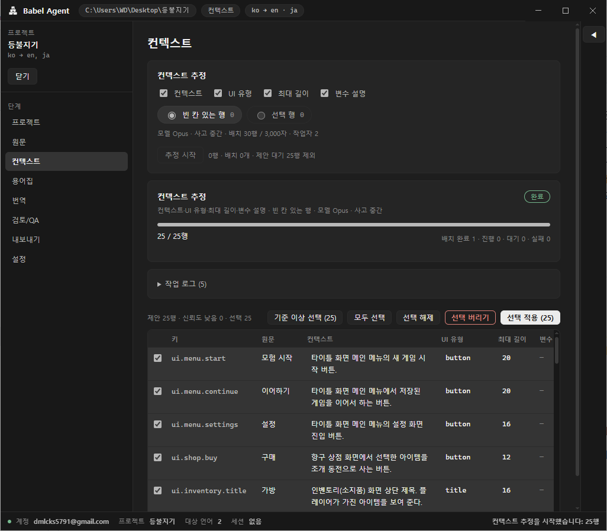

> **제안은 [선택 적용]을 누르기 전까지 원문에 들어가지 않습니다.** 안심하고 확인하고 고치세요. 이미 채워져 있던 칸은 건드리지 않습니다.

> **신뢰도가 낮은 제안**은 직접 고쳤더라도 [기준 이상 선택]에 들어가지 않습니다. 적용하려면 그 줄의 체크 칸을 직접 체크하세요. 그대로 두고 넘어가도 됩니다.

<br>

## 6. 용어집 만들기

캐릭터 이름, 지명, 아이템처럼 **게임 내내 같은 이름으로 옮겨야 하는 말**을 정리합니다.

1. 왼쪽 메뉴에서 [용어집]을 누릅니다.
2. **용어 추출** 카드에서 [추출 시작]을 누릅니다. 에이전트가 원문에서 `반디`, `별빛 기름` 같은 용어를 찾아 **승인 대기**로 올립니다. 이때 번역 칸은 아직 비어 있습니다.
3. 추출이 끝나면 **용어 번역** 카드에서 [번역 시작]을 누릅니다. 빈 번역 칸이 영어·일본어로 채워집니다.
4. 목록 위의 필터에서 [승인 대기]를 누르고, [보이는 행 선택]을 누른 뒤 [선택 승인]을 누릅니다.

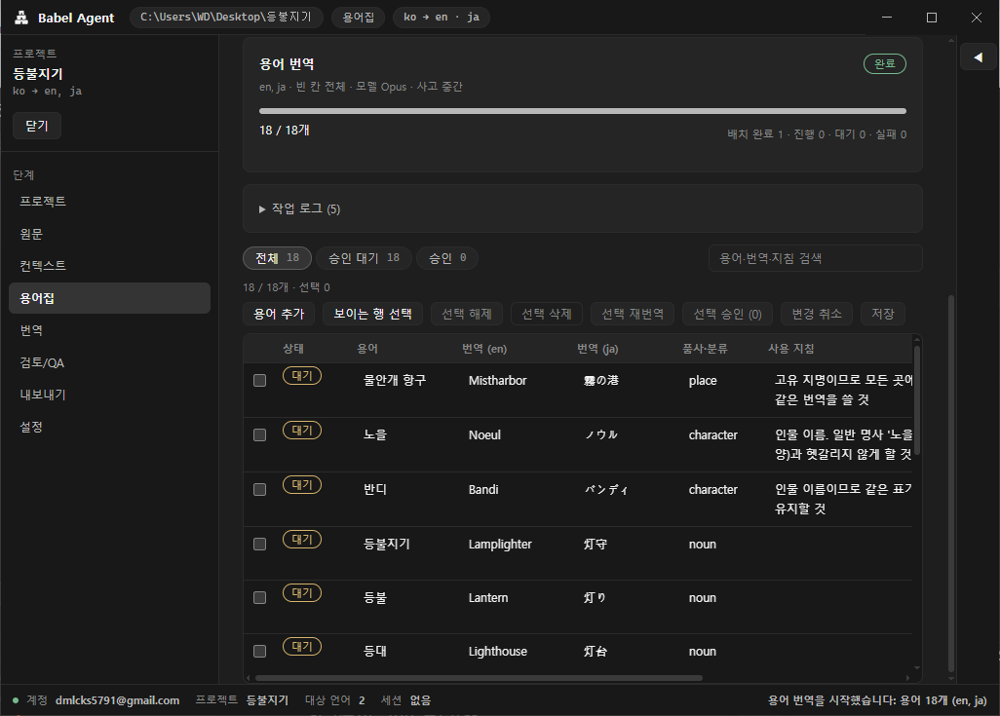

> **승인한 용어만** 번역에 쓰입니다. 마음에 들지 않는 용어는 체크를 풀고 승인하거나, [선택 삭제]로 지웁니다.

<br>

## 7. 번역하기

1. 왼쪽 메뉴에서 [번역]을 누릅니다.
2. 대상 언어가 `en`, 범위가 **미번역**인지 확인하고 [번역 시작]을 누릅니다.
3. 진행 막대와 작업 로그가 보입니다. **완료**가 될 때까지 기다립니다.
4. 대상 언어를 `ja`로 바꾸고 다시 [번역 시작]을 누릅니다.

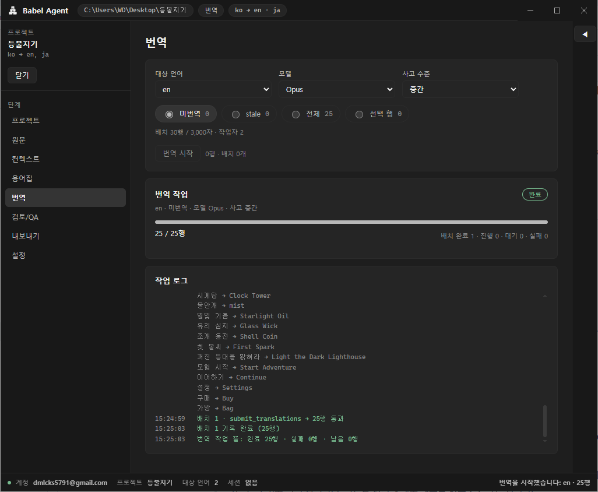

> 번역 요청에는 3단계의 게임 소개 · 톤 가이드, 5단계의 컨텍스트, 6단계의 용어가 함께 들어갑니다.

> **사용량 한도에 걸리면** 앱이 작업을 멈추고 기다렸다가, 한도가 풀리면 이어서 번역합니다. 따로 할 일은 없습니다.

<br>

## 8. 검토하고 승인하기

번역이 끝나면 앱이 줄마다 자동으로 검사(QA)합니다. 변수나 태그가 빠졌는지, 길이가 넘치는지, 용어집을 지켰는지 봅니다. 여러분은 **문제없는 줄을 한 번에 승인하고, 남은 줄만 보면** 됩니다.

> **영어나 일본어를 잘 몰라도 괜찮습니다.** 에이전트는 번역하면서 메모를 남깁니다. 어떻게 옮겼는지, 확신이 없는 곳은 왜 그런지 원문 언어(이 예제에서는 한국어)로 적어 둡니다. 번역문을 읽지 못해도 **메모를 읽고 판단**하면 됩니다.

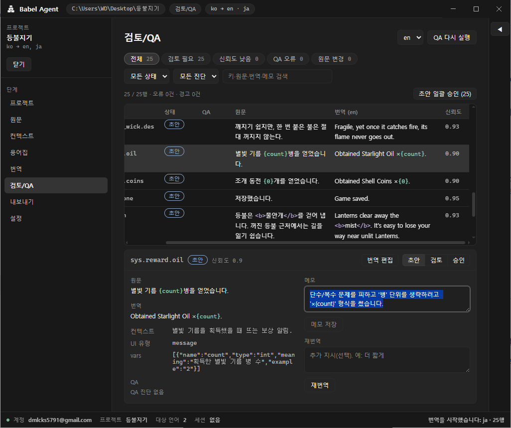

1. 왼쪽 메뉴에서 [검토/QA]를 누릅니다. 오른쪽 위의 언어가 `en`인지 확인합니다.
2. [초안 일괄 승인]을 누르고, 확인 창에서 [n행 승인]을 누릅니다. 검사를 통과하고 에이전트가 자신 있게 번역한 줄이 한 번에 승인됩니다.
3. 위쪽 필터에서 [QA 오류]와 [신뢰도 낮음]을 차례로 눌러, 남은 줄을 확인합니다. 줄을 누르면 아래에 원문 · 번역 · 검사 결과 · **에이전트 메모**가 보입니다. 메모와 검사 결과를 읽고 정합니다.
   - **괜찮다면** [승인]을 누릅니다.
   - **고치고 싶다면** 재번역 칸에 `더 짧게`처럼 원하는 점을 적고 [재번역]을 누릅니다. 새 후보가 나오면 [적용]을 누른 뒤 [승인]을 누릅니다.
   - 직접 고쳐도 됩니다. 번역을 더블클릭해 고치고 `Ctrl+Enter`로 저장합니다.
4. 언어를 `ja`로 바꾸고 2~3번을 반복합니다.

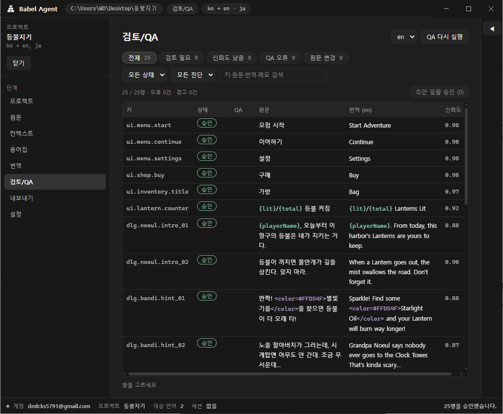

> **QA 오류가 남은 줄은 승인할 수 없고, 내보내기도 막힙니다.** [QA 오류] 필터가 비면 다 된 것입니다.

### 해 보기: 에이전트에게 스타일 규칙 부탁하기

번역을 보다가 "반디 대사가 좀 더 신났으면 좋겠다" 싶을 때가 있습니다. 이럴 때 규칙을 직접 적을 필요 없이 에이전트에게 말하면 됩니다.

1. 오른쪽 **에이전트** 패널의 입력칸에 이렇게 적고 Enter를 누릅니다. 패널이 접혀 있으면 오른쪽 끝의 ◀ 버튼으로 펼칩니다.
   ```
   앞으로 반디 대사는 문장 끝에 느낌표를 자주 써서 들뜬 느낌을 살려 줘
   ```
2. **스타일 규칙 추가 제안** 카드가 뜨면 [저장]을 누릅니다.

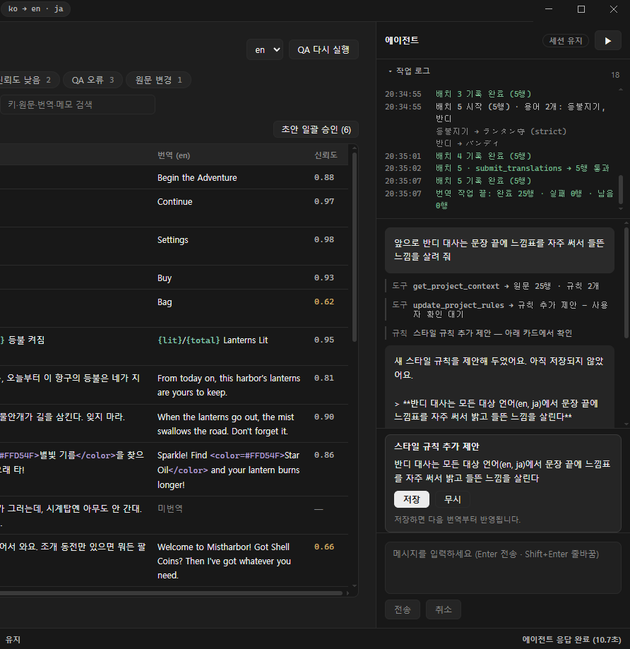

저장한 규칙은 **다음 번역부터** 들어갑니다. 이미 번역한 반디 대사(`dlg.bandi.…`)에 적용하려면 그 줄을 골라 [재번역]하세요. 규칙은 프로젝트 화면에서 언제든 고치거나 지울 수 있습니다.

<br>

## 9. 내보내기

1. 왼쪽 메뉴에서 [내보내기]를 누릅니다.
2. **내보낼 언어**에 `ko`, `en`, `ja`가 모두 체크되어 있는지 봅니다.
3. 아래 **헤더 미리보기**에서 만들어질 열 이름(`Key`, `Id`, `Korean(ko)`, `English(en)`, `Japanese(ja)`)을 확인합니다.
4. 오른쪽 위의 [내보내기]를 누릅니다.

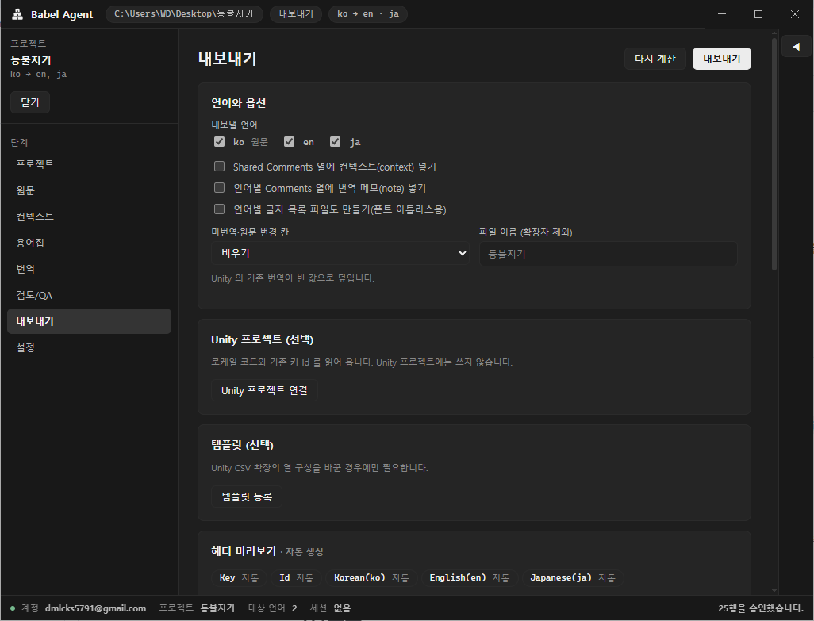

끝났습니다! 프로젝트 폴더의 `export/`에 번역이 담긴 CSV가 만들어집니다.

> [내보내기] 버튼이 눌리지 않으면 아직 QA 오류가 남은 것입니다. 화면에 뜬 [검토에서 보기]로 그 줄을 열어 고치세요.

<br>

## 다음으로

- 내보낸 CSV를 Unity로 가져오는 방법과 Unity 없이 쓰는 방법 — [README의 내보내기](../README.md#6-내보내기--unity에-바로-다른-곳에도-그대로)
- 내 게임으로 시작하기 — 새 프로젝트를 만들고, 지금 쓰는 원문 CSV를 [원문 가져오기]로 불러오거나 [빈 원문 파일 만들기]로 처음부터 적어 나가면 됩니다.
